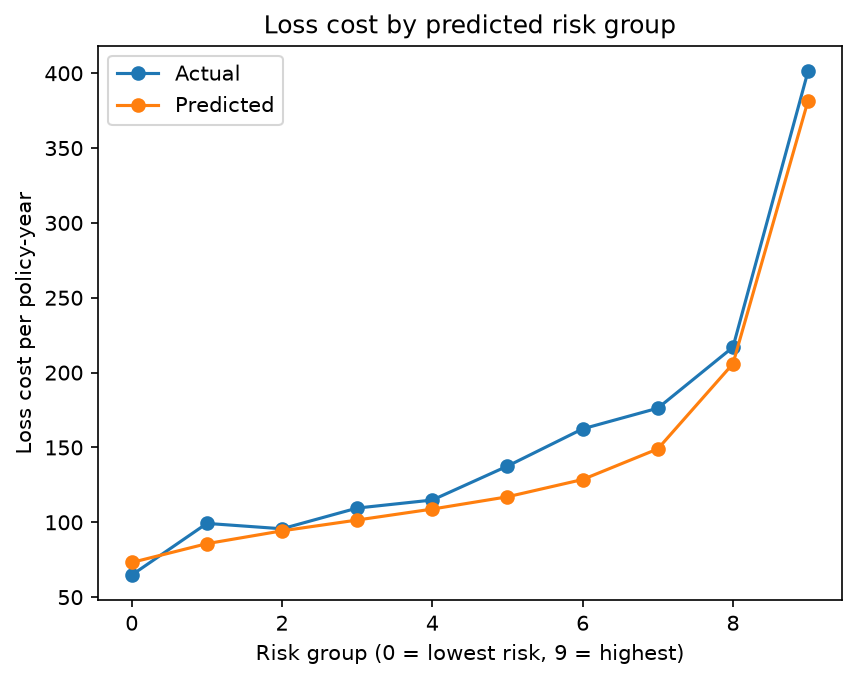

# Motor Insurance Pricing: Frequency-Severity GLM

## Goal
Build a pure premium model for motor insurance using a Poisson
frequency GLM and a Gamma severity GLM.

## Data
French motor third-party liability dataset (freMTPL2, from OpenML):
about 678,000 policies and 26,600 claims.

## Method
- Frequency: Poisson GLM, log link, log(Exposure) as offset
- Severity: Gamma GLM, log link, weighted by claim count
- Pure premium = frequency x severity
- 75/25 train/test split (random_state=42)

## Data cleaning
- Exposure capped at 1 year
- Claim counts capped at 4 per policy
- Claim amounts capped at 100,000
- Claim counts defined from the severity table so frequency and
  severity describe the same claims

## Results
- Training: predicted total loss within 0.1% of actual
- Test: predicted 8.4% below actual
- Lift chart: actual loss cost rises from about 65 (lowest risk
  group) to about 401 (highest), predicted from 73 to 382

- Key frequency relativities (vs base: age 18-25, vehicle 0-2 yrs,
  Diesel, Area A): Area F 1.51, Regular fuel 0.83, BonusMalus
  +3% per point. Driver ages 36+ come out above the 18-25 base,
  which is unexpected; BonusMalus may overlap with age but I
  did not test this.

## What went wrong first
My first version over-predicted total loss by 25%. Frequency
counted 36,056 claims but only 26,639 had amounts, so unpriced
claims inflated the total. Redefining claim counts from the
severity data fixed it.

## Limitations
- Single portfolio, no inflation or trend
- No expenses, profit or risk loading
- Severity model uses only driver age and fuel type, and
  predictions are flatter than actuals in the middle risk groups
- Vehicle age effect is weak in this model
- Large claims capped, not modelled separately
- No interaction effects tested

## Next steps
Add more rating factors to severity, model large losses
separately, compare with gradient boosting.