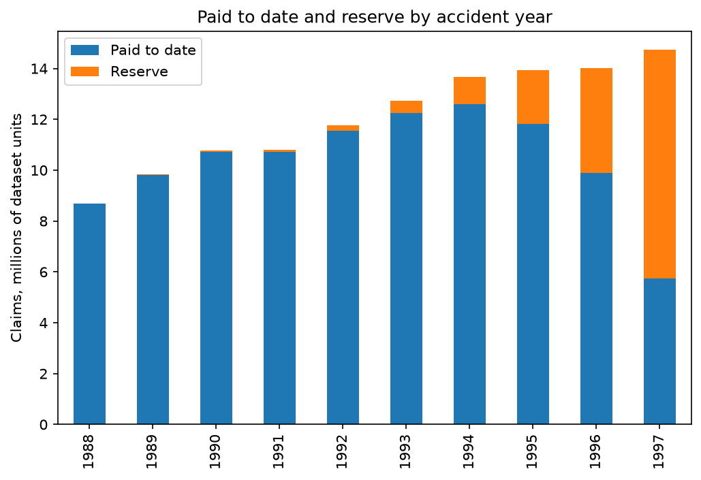

# Motor Reserving: Chain Ladder with Mack Standard Error

## Goal
Estimate outstanding claims (reserves) for a motor portfolio with
the chain ladder method, and measure how uncertain the estimate is.

## Data
Private passenger auto cumulative paid claims, accident years
1988-1997, development ages 12-120 months. Source: "clrd" sample
(CAS Loss Reserving Database, from NAIC Schedule P) in the Python
chainladder package, summed across companies. This is US industry
data, not a single insurer's portfolio. Amounts are in the
dataset's own units; I did not confirm the currency scale, so all
figures are shown in those units.

## Method
- Volume-weighted age-to-age development factors, calculated by
  hand in pandas
- Each accident year projected to the last age;
  Reserve = Ultimate - Paid to date
- Checked against the chainladder package; Mack standard error
  taken from the package

## Results
- Total reserve: 17,138,458 (dataset units), matching the package
  to rounding
- Mack standard error of the total: 699,005 (about 4.1%)
- 1997 has the largest reserve (8,972,484, about 61% of its
  ultimate) and the largest standard error in absolute terms
- Relative to its own reserve, the error is largest for the oldest
  years, where reserves are small

## Limitations
- No tail factor beyond 120 months, so the reserve is likely
  slightly understated
- Paid claims only; no incurred or case reserve data
- One method only (no Bornhuetter-Ferguson comparison)
- No adjustment for inflation or large claims
- Industry aggregate data, not a real portfolio
- Mack's formula assumes accident years are independent

## Next steps
Add a tail factor, build an incurred triangle, compare with
Bornhuetter-Ferguson, and check development factors for outliers.